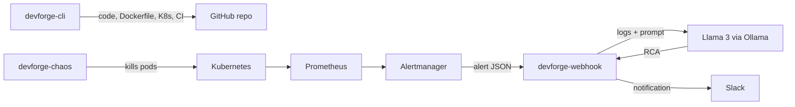

# Augmented Internal Developer Platform (IDP)

An internal developer platform that **builds** services in seconds and **heals** them when they break, using automation and a local AI model.

- **Day-1 (Builder):** `devforge-cli` (Go) asks what you want, uses AI to generate starter code, produces Docker + Kubernetes files and a CI/CD pipeline, and pushes everything to GitHub.
- **Day-2 (SRE & Healer):** `devforge-chaos` (Python) randomly deletes pods to prove the cluster self-heals. Prometheus/Alertmanager detect it and call `devforge-webhook` (Go), which asks a local Llama 3 model for a Root Cause Analysis (RCA) and posts it to Slack.



## Design principles

- **100% free & open source.** No paid cloud services, no paid APIs. Everything runs locally.
- **Everything in Docker.** Anyone with Docker should be able to run the whole project with one command and no language toolchains installed.
- **CV-ready.** Each feature should be demonstrable, documented, and tested.

## Repository layout

| Path | What it is |
|------|-----------|
| `devforge-cli/` | Go CLI that scaffolds services (Cobra). Templates live in `cmd/templates/` |
| `devforge-chaos/` | Python chaos engine (experiments, MTTR, reports, kill switch) + RBAC; runs as a container or a pod |
| `devforge-webhook/` | Go webhook: alert group → incident → evidence + runbooks → Llama 3 → Slack |
| `examples/` | Sample services generated by the CLI |
| `monitoring/` | Prometheus, Alertmanager and Grafana config used by Compose |
| `docker-compose.yml` | The whole stack in one file |
| `runbooks/` | Markdown runbooks indexed into Qdrant for retrieval |
| `alertmanager-values.yaml` | Alertmanager config for the Prometheus Helm chart (Minikube flow) |

## Quick start (Docker only)

Prerequisite: **Docker Desktop** (or Docker Engine + Compose). Nothing else to install: no Go, Python, kubectl or Minikube.

```bash
cp .env.example .env        # optional: add SLACK_WEBHOOK_URL to get RCAs in Slack
docker compose up -d --build                  # core stack
docker compose --profile k8s up -d --build    # + throwaway k3s cluster, demo app, chaos engine
docker compose logs -f webhook chaos          # watch kills and RCAs
```

The first run downloads the Llama 3 model (~4.7 GB) and the `nomic-embed-text` embedding model (~270 MB). To try it faster, set `OLLAMA_MODEL=qwen2.5:0.5b` in `.env` (answers will be much weaker; keep the default embedding model, since chat models cannot embed).
With `make` installed you can use `make up`, `make chaos`, `make demo` (fake alert, no cluster needed), `make down`, `make clean`.

| Service | URL |
|---------|-----|
| Webhook | http://localhost:9090/healthz, incidents at http://localhost:9090/incidents |
| Prometheus | http://localhost:9091 |
| Alertmanager | http://localhost:9093 |
| Grafana | http://localhost:3000 (admin / `GRAFANA_PASSWORD`, default `admin`) |
| Ollama | http://localhost:11435 |

How it flows: chaos engine injects a fault into a pod in k3s, exposes `chaos_last_injection_timestamp_seconds`, Prometheus fires `ChaosFaultInjected`, Alertmanager calls the webhook, the webhook asks Ollama for an RCA and posts it to Slack (or the console if no Slack URL is set).

## Using the CLI

Run it from Docker so nothing needs installing (the folder you mount receives the generated project):

```bash
docker build -t devforge-cli ./devforge-cli
docker run --rm -v "$PWD:/workspace" devforge-cli create --name billing-service --lang python --dry-run   # preview only
docker run --rm -v "$PWD:/workspace" devforge-cli create --name billing-service --lang python
docker run --rm -v "$PWD:/workspace" devforge-cli list
```

| Flag | Meaning |
|------|---------|
| `--lang go\|python\|node` | Built-in template (default `go`) |
| `--dry-run` / `--plan` | Show every file that would be created; write nothing |
| `--ai` | Also write a README using your local Ollama (`OLLAMA_URL`, `OLLAMA_MODEL`) |
| `--db` | Database name, passed to the app as a `DATABASE_URL` hint |

Set `GITHUB_USERNAME` and `GITHUB_TOKEN` to also create `devforge-app-<name>` and `devforge-manifests-<name>` repositories. Every service gets `/health`, `/ready`, `/metrics`, tests, an availability SLO with burn-rate alerts (`--slo`, default 99.9) and a `promtool` test for them, Kustomize `base/` + `overlays/dev|staging`, alert rules, a Grafana dashboard, and a CI pipeline (tests, gitleaks, Trivy). Created services are listed by `devforge list` from `.devforge/catalog.json`.

## Chaos engine

`devforge-chaos` runs one experiment at a time, then measures how long the workload takes to become healthy again (MTTR).

| Experiment | What it does | Recovery stopwatch starts |
|---|---|---|
| `pod-kill` | Deletes a pod | when the pod is deleted |
| `memory-stress` | Fills `/dev/shm` (counted as container memory) for `CHAOS_DURATION_SECONDS` | when the stress is removed |
| `cpu-stress` | Busy loops for `CHAOS_DURATION_SECONDS` | when the stress is removed |
| `node-drain` | Cordons the node, evicts the workload's pods, uncordons after the duration | at eviction (the outage counts) |

The stress tests run shell commands inside the target, so the container needs `sh`, `dd`, `timeout` and `killall` (not distroless images). A target with no resource limits usually shows ~0s recovery for stress tests, meaning no impact.

**Safety controls** (environment variables on the `chaos` service)

| Variable | Default | Purpose |
|---|---|---|
| `TARGET_NAMESPACE`, `TARGET_SELECTOR` | `default`, none | Where to attack; selector is a label selector like `app=demo-app` |
| `CHAOS_EXPERIMENTS` | `pod-kill` | Comma list of the experiments above |
| `CHAOS_MAX_TARGETS` | `1` | Blast radius: pods affected per experiment |
| `CHAOS_ALLOW_NAMESPACES` / `CHAOS_DENY_NAMESPACES` | target only / `kube-system,kube-public,kube-node-lease` | The engine refuses to start on a denied namespace |
| `chaos.devforge/exclude: "true"` (pod label) | | Opt a pod out of all experiments |
| `CHAOS_DRY_RUN=true` | `false` | Log what would happen; touch nothing, raise no alerts |
| `CHAOS_ALLOW_SINGLE_NODE_DRAIN` | `false` | `node-drain` refuses to drain the only node unless set |

**Kill switch:** `make chaos-pause` stops new experiments at once and aborts a running stress or drain (the fault is removed in a `finally` block); `make chaos-resume` continues. If the engine dies mid-drain, the next start uncordons the node.

**Results:** `chaos_experiments_total{experiment,result}`, `chaos_recovery_seconds` (histogram) and `chaos_last_recovery_seconds` in Prometheus, the **Chaos Engineering** dashboard in Grafana (provisioned automatically), and `reports/chaos-report.md` plus `reports/results.jsonl` rewritten after every experiment (`make chaos-report`).

Run its tests: `docker run --rm -v "${PWD}/devforge-chaos:/app" -w /app python:3.12-slim sh -c "pip install -q -r requirements-dev.txt && pytest -q"`

## Incidents, runbooks and Slack

**Grouping and dedup.** Alertmanager groups alerts by name and namespace (`monitoring/alertmanager.yml`), so a wave of pod failures arrives as one notification. The webhook turns each group into one **incident** in SQLite (`webhook-data` volume) and runs one RCA. Repeat notifications for the same group within `DEDUP_WINDOW_SECONDS` (default 10 minutes) are folded into the open incident, and a "resolved" notification closes it.

**Incident pages.** `http://localhost:9090/incidents` lists incidents and `/incidents/<id>` shows the stored RCA. The pages are read-only but not password protected, so do not expose port 9090 publicly.

**Timeline.** The prompt includes a time-ordered timeline built from the alert start times and Kubernetes events, and the RCA must include a *Timeline* section taken only from it.

**Runbook retrieval.** On start the webhook splits `runbooks/*.md` at `##` headings, embeds each section with Ollama (`EMBED_MODEL`) and stores it in Qdrant. For each incident it retrieves the closest sections (score at least `RAG_MIN_SCORE`) and tells the model to cite them. Add your own runbooks as Markdown files in `runbooks/` and restart the webhook. When someone clicks **Acknowledge**, that incident's RCA is also indexed, so later incidents can find it; unacknowledged and fallback reports are never indexed.

**Slack buttons.** Set `SLACK_SIGNING_SECRET` (and use a Slack app with Interactivity pointing at `https://<public-host>/slack/actions`) to get **Acknowledge** and **Restart workload** buttons. Requests are verified with Slack's HMAC signature and rejected if older than five minutes. Restart does a rolling restart of the Deployment derived from the pod name (`web-5d-abc` → `web`), after a confirmation dialog. Without the secret the message is plain text and the endpoint is disabled.

| Variable | Default | Purpose |
|---|---|---|
| `DEDUP_WINDOW_SECONDS` | `600` | Alerts for the same group join the open incident |
| `QDRANT_URL` | set in Compose | Empty disables retrieval; RCAs still work |
| `EMBED_MODEL` | `nomic-embed-text` | Ollama model used for embeddings |
| `RAG_MIN_SCORE`, `RAG_RESULTS` | `0.4`, `3` | Retrieval cut-off and number of sections |
| `PUBLIC_URL` | `http://localhost:9090` | Base URL in links inside Slack messages |

---

# Roadmap / Task list

All tools listed are **free and open source**. Tick items off as they are completed.

## Phase 0 — Housekeeping (do first)

- [ ] Remove `devforge-webhook/.env` from git history and rotate the Slack webhook URL (`.env` is now untracked; history rewrite and rotation still pending)
- [x] Add `.env.example` with placeholder values; add `.env` to `.gitignore`
- [x] Add a root `.gitignore`, `LICENSE` (MIT), and `CONTRIBUTING.md`
- [x] Move generated sample apps (`billing-service`, `notification-api`) to `examples/`
- [x] Add architecture diagram to this README

## Phase 1 — One-command Docker setup (anyone can run it)

- [x] `devforge-webhook/Dockerfile` (multi-stage build, small final image, non-root)
- [x] Verify `devforge-chaos/Dockerfile` and `devforge-cli/Dockerfile` build cleanly
- [x] Root `docker-compose.yml` running: webhook, Ollama (+ auto-pull `llama3`), Prometheus, Alertmanager, Grafana, a sample target app
- [x] Containerised local Kubernetes using **k3s** inside Compose (free) so no Minikube install is needed
- [x] `Makefile` with `make up`, `make down`, `make chaos`, `make demo`
- [x] Healthchecks and `depends_on` ordering in compose
- [x] Replace `host.minikube.internal` with a configurable webhook URL
- [ ] "Run it in 5 minutes" section in this README with a demo GIF

## Phase 2 — Real data in the RCA (biggest quality win)

- [x] Webhook fetches real pod logs (`--previous`), events, and `describe` info via the Kubernetes API (`client-go`) instead of simulated logs
- [ ] Webhook queries Prometheus for CPU, memory, and restart count at time of failure (partial: restart counts of sibling pods and chaos-kill stats are included; CPU/memory need cAdvisor or kube-state-metrics)
- [x] Improve the prompt with structured sections: Summary, Likely cause, Evidence, Suggested fix
- [x] Timeouts, retries, and a fallback message when Ollama is unavailable
- [x] Authentication on `/alert` (shared secret / token header)
- [x] Structured JSON logging and a `/healthz` endpoint
- [x] Unit tests for payload parsing and prompt building (run: `docker run --rm -v "${PWD}/devforge-webhook:/app" -w /app golang:1.22 go test ./...`)

## Phase 3 — Observability built into every generated service

- [x] CLI templates include `/health`, `/ready` and `/metrics` (Prometheus client) endpoints (Go template; other languages still use the AI model and are not guaranteed)
- [x] Generate a `ServiceMonitor` and default alert rules per service (down, high error rate, high latency; also as `PrometheusRule` and plain `alerts.rules.yml`)
- [x] Generate a Grafana dashboard JSON per service
- [x] Add resource requests/limits, HPA, and PodDisruptionBudget to generated manifests
- [x] Non-root user and read-only filesystem defaults in generated Dockerfiles and Deployments (distroless runtime image)

## Phase 4 — Day-1 CLI improvements

- [x] Language templates: Go, Python (FastAPI), Node.js (each with its own tests, metrics and non-root Dockerfile)
- [x] `--dry-run` / `--plan` mode that prints what will be created
- [x] Optional AI backend via local Ollama (no paid API required): `--ai` generates the service README; not run against a real model yet
- [x] `devforge list` to show services created (simple local JSON service catalog)
- [x] Generated CI pipeline: build, test, **Trivy** image scan, **gitleaks** secret scan (GitHub Actions free tier)
- [x] Kustomize overlays (dev/staging) for generated services (Helm not used)
- [x] Unit tests for template rendering

## Phase 5 — Better chaos engineering

- [x] Additional experiments: pod kill, CPU stress, memory stress, node drain (network latency not done: it needs `tc` and NET_ADMIN inside the target container)
- [x] Config for target namespace, label selector, interval, and an allow/deny list (blast-radius control)
- [x] Kill switch and dry-run mode
- [x] Record recovery time (MTTR) per experiment and expose it as a Prometheus metric
- [x] Generate a markdown chaos report (HTML not done) after each run
- [x] Grafana dashboard: chaos events vs. recovery time

## Phase 6 — SRE features

- [x] Define SLOs per service (`devforge create --slo 99.9`; multiwindow burn-rate alerts, validated by a generated `promtool` unit test) and alert on error-budget burn rate (Prometheus recording rules)
- [x] Alert deduplication and grouping so Slack isn't spammed
- [x] LLM-written incident timeline summary
- [x] Runbook "RAG": embed runbooks and past RCAs in a free vector store (Chroma or Qdrant in Docker) and feed relevant context to the model
- [ ] Slack interactive buttons (Acknowledge, Restart, Rollback) calling back into the webhook (partial: Acknowledge and Restart are built, signed and unit-tested; Rollback is Phase 7; not tried against real Slack, which needs a public HTTPS URL)
- [x] Store past incidents in SQLite/Postgres and expose a small `/incidents` page

## Phase 7 — Auto-remediation

- [ ] Rule-based safe actions (restart, rollback to previous ReplicaSet) with human approval
- [ ] Webhook opens a GitHub pull request proposing a fix (e.g. raise memory limit) based on the RCA
- [ ] Audit log of every automated action

## Phase 8 — GitOps & platform polish

- [ ] **Argo CD** (free) deploys CLI-generated services from Git instead of `kubectl apply`
- [ ] Simple web UI (or CLI TUI) over the service catalog and incidents
- [ ] Optional Backstage-style catalog metadata (`catalog-info.yaml`) per service
- [ ] Optional OpenCost (free) dashboard for per-service cost

## Phase 9 — Quality, CI, and CV polish

- [ ] GitHub Actions for this repo: lint (`golangci-lint`, `ruff`), unit tests, Docker build, compose smoke test
- [ ] End-to-end test in CI using kind: deploy sample app → kill pod → assert alert fires
- [ ] Badges (build, license) at the top of this README
- [ ] Demo video / GIF and screenshots of Slack RCA and Grafana
- [ ] "What I learned / design decisions" section for interviews
- [ ] Short CV bullet points (see below)

---

## Free technology stack

| Purpose | Tool (all free / open source) |
|---------|------------------------------|
| Containers | Docker, Docker Compose |
| Local Kubernetes | kind or k3d (alternative: Minikube) |
| Metrics & alerts | Prometheus, Alertmanager, Grafana |
| Local LLM | Ollama + Llama 3 |
| Languages | Go, Python |
| CI/CD | GitHub Actions (free tier) |
| Security scanning | Trivy, gitleaks |
| GitOps | Argo CD |
| Vector store (optional) | Chroma or Qdrant |
| Chat notifications | Slack incoming webhooks (free plan) |

## CV bullet ideas (update as features land)

- Built an internal developer platform in Go that scaffolds production-ready microservices (Dockerfile, Kubernetes manifests, CI/CD) and pushes to GitHub in seconds.
- Developed a Python chaos-engineering engine that injects pod failures into Kubernetes to validate self-healing and measure MTTR.
- Implemented an AI-assisted incident pipeline (Prometheus → Alertmanager → Go webhook → local Llama 3) that posts root-cause analyses to Slack.
- Containerised the entire platform with Docker Compose so it runs end-to-end with a single command using only free, open-source tooling.
