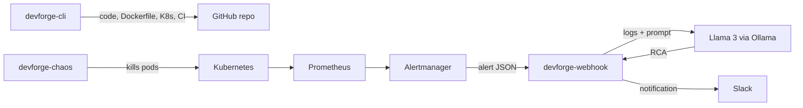

# Augmented Internal Developer Platform (IDP)

An internal developer platform that **builds** services in seconds and **heals** them when they break, using automation and a local AI model.

- **Day-1 (Builder):** `devforge-cli` (Go) asks what you want, uses AI to generate starter code, produces Docker + Kubernetes files and a CI/CD pipeline, and pushes everything to GitHub.
- **Day-2 (SRE & Healer):** `devforge-chaos` (Python) randomly deletes pods to prove the cluster self-heals. Prometheus/Alertmanager detect it and call `devforge-webhook` (Go), which asks a local Llama 3 model for a Root Cause Analysis (RCA) and posts it to Slack.



## Design principles

- **100% free & open source.** No paid cloud services, no paid APIs. Everything runs locally.
- **Everything in Docker.** Anyone with Docker should be able to run the whole project with one command and no language toolchains installed.
- **CV-ready.** Each feature should be demonstrable, documented, and tested.

## Repository layout

| Path | What it is |
|------|-----------|
| `devforge-cli/` | Go CLI that scaffolds services (Cobra) |
| `devforge-chaos/` | Python chaos engine + RBAC, runs as a pod |
| `devforge-webhook/` | Go webhook: alert → logs → Llama 3 → Slack |
| `examples/` | Sample services generated by the CLI |
| `alertmanager-values.yaml` | Alertmanager config for the Prometheus Helm chart |

## Current quick start (manual)

Prerequisites: Docker Desktop, Minikube, Ollama (with `llama3` pulled), a Slack incoming webhook.

1. **Webhook** (terminal 1), from `devforge-webhook/`:
   ```powershell
   docker run --rm -v "${PWD}:/app" -w /app --env-file .env -p 9090:9090 golang:1.22 go run main.go
   ```
2. **Check targets** (terminal 2): `kubectl get pods`
3. **Chaos**, from `devforge-chaos/`: `kubectl apply -f rbac.yaml -f chaos-pod.yaml`
4. Watch terminal 1 and Slack for the RCA.

> The goal of Phase 1 below is to replace this with a single `docker compose up`.

---

# Roadmap / Task list

All tools listed are **free and open source**. Tick items off as they are completed.

## Phase 0 — Housekeeping (do first)

- [ ] Remove `devforge-webhook/.env` from git history and rotate the Slack webhook URL (`.env` is now untracked; history rewrite and rotation still pending)
- [x] Add `.env.example` with placeholder values; add `.env` to `.gitignore`
- [x] Add a root `.gitignore`, `LICENSE` (MIT), and `CONTRIBUTING.md`
- [x] Move generated sample apps (`billing-service`, `notification-api`) to `examples/`
- [x] Add architecture diagram to this README

## Phase 1 — One-command Docker setup (anyone can run it)

- [ ] `devforge-webhook/Dockerfile` (multi-stage build, small final image, non-root)
- [ ] Verify `devforge-chaos/Dockerfile` and `devforge-cli/Dockerfile` build cleanly
- [ ] Root `docker-compose.yml` running: webhook, Ollama (+ auto-pull `llama3`), Prometheus, Alertmanager, Grafana, a sample target app
- [ ] Containerised local Kubernetes using **kind** or **k3d** (free) so no Minikube install is needed
- [ ] `Makefile` with `make up`, `make down`, `make chaos`, `make demo`, `make test`
- [ ] Healthchecks and `depends_on` ordering in compose
- [ ] Replace `host.minikube.internal` with a configurable webhook URL
- [ ] "Run it in 5 minutes" section in this README with a demo GIF

## Phase 2 — Real data in the RCA (biggest quality win)

- [ ] Webhook fetches real pod logs (`--previous`), events, and `describe` info via the Kubernetes API (`client-go`) instead of simulated logs
- [ ] Webhook queries Prometheus for CPU, memory, and restart count at time of failure
- [ ] Improve the prompt with structured sections: Summary, Likely cause, Evidence, Suggested fix
- [ ] Timeouts, retries, and a fallback message when Ollama is unavailable
- [ ] Authentication on `/alert` (shared secret / token header)
- [ ] Structured JSON logging and a `/healthz` endpoint
- [ ] Unit tests for payload parsing and prompt building

## Phase 3 — Observability built into every generated service

- [ ] CLI templates include `/health` and `/metrics` (Prometheus client) endpoints
- [ ] Generate a `ServiceMonitor` and default alert rules per service
- [ ] Generate a Grafana dashboard JSON per service
- [ ] Add resource requests/limits, HPA, and PodDisruptionBudget to generated manifests
- [ ] Non-root user and read-only filesystem defaults in generated Dockerfiles

## Phase 4 — Day-1 CLI improvements

- [ ] Language templates: Go, Python (FastAPI), Node.js
- [ ] `--dry-run` / `--plan` mode that prints what will be created
- [ ] Optional AI backend via local Ollama (no paid API required)
- [ ] `devforge list` to show services created (simple local JSON service catalog)
- [ ] Generated CI pipeline: build, test, **Trivy** image scan, **gitleaks** secret scan (GitHub Actions free tier)
- [ ] Helm chart or Kustomize overlays (dev/staging) for generated services
- [ ] Unit tests for template rendering

## Phase 5 — Better chaos engineering

- [ ] Additional experiments: pod kill, CPU stress, memory stress, network latency, node drain
- [ ] Config for target namespace, label selector, interval, and an allow/deny list (blast-radius control)
- [ ] Kill switch and dry-run mode
- [ ] Record recovery time (MTTR) per experiment and expose it as a Prometheus metric
- [ ] Generate a markdown/HTML chaos report after each run
- [ ] Grafana dashboard: chaos events vs. recovery time

## Phase 6 — SRE features

- [ ] Define SLOs per service and alert on error-budget burn rate (Prometheus recording rules)
- [ ] Alert deduplication and grouping so Slack isn't spammed
- [ ] LLM-written incident timeline summary
- [ ] Runbook "RAG": embed runbooks and past RCAs in a free vector store (Chroma or Qdrant in Docker) and feed relevant context to the model
- [ ] Slack interactive buttons (Acknowledge, Restart, Rollback) calling back into the webhook
- [ ] Store past incidents in SQLite/Postgres and expose a small `/incidents` page

## Phase 7 — Auto-remediation

- [ ] Rule-based safe actions (restart, rollback to previous ReplicaSet) with human approval
- [ ] Webhook opens a GitHub pull request proposing a fix (e.g. raise memory limit) based on the RCA
- [ ] Audit log of every automated action

## Phase 8 — GitOps & platform polish

- [ ] **Argo CD** (free) deploys CLI-generated services from Git instead of `kubectl apply`
- [ ] Simple web UI (or CLI TUI) over the service catalog and incidents
- [ ] Optional Backstage-style catalog metadata (`catalog-info.yaml`) per service
- [ ] Optional OpenCost (free) dashboard for per-service cost

## Phase 9 — Quality, CI, and CV polish

- [ ] GitHub Actions for this repo: lint (`golangci-lint`, `ruff`), unit tests, Docker build, compose smoke test
- [ ] End-to-end test in CI using kind: deploy sample app → kill pod → assert alert fires
- [ ] Badges (build, license) at the top of this README
- [ ] Demo video / GIF and screenshots of Slack RCA and Grafana
- [ ] "What I learned / design decisions" section for interviews
- [ ] Short CV bullet points (see below)

---

## Free technology stack

| Purpose | Tool (all free / open source) |
|---------|------------------------------|
| Containers | Docker, Docker Compose |
| Local Kubernetes | kind or k3d (alternative: Minikube) |
| Metrics & alerts | Prometheus, Alertmanager, Grafana |
| Local LLM | Ollama + Llama 3 |
| Languages | Go, Python |
| CI/CD | GitHub Actions (free tier) |
| Security scanning | Trivy, gitleaks |
| GitOps | Argo CD |
| Vector store (optional) | Chroma or Qdrant |
| Chat notifications | Slack incoming webhooks (free plan) |

## CV bullet ideas (update as features land)

- Built an internal developer platform in Go that scaffolds production-ready microservices (Dockerfile, Kubernetes manifests, CI/CD) and pushes to GitHub in seconds.
- Developed a Python chaos-engineering engine that injects pod failures into Kubernetes to validate self-healing and measure MTTR.
- Implemented an AI-assisted incident pipeline (Prometheus → Alertmanager → Go webhook → local Llama 3) that posts root-cause analyses to Slack.
- Containerised the entire platform with Docker Compose so it runs end-to-end with a single command using only free, open-source tooling.
