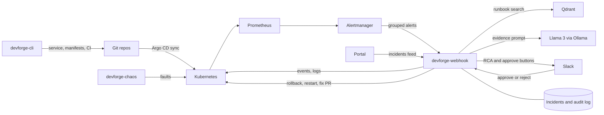

# Augmented Internal Developer Platform (IDP)

[](https://github.com/tilaknagunawardhane/Devforge-AI/actions/workflows/ci.yml)
[](LICENSE)


An internal developer platform that **builds** services in seconds and **heals** them when they break, using automation and a local AI model. Everything runs in Docker with free, open-source tools.

- **Day-1 (Builder):** `devforge-cli` (Go) renders tested templates for Go, Python or Node into a service with health checks, Prometheus metrics, tests, hardened Kustomize manifests (dev and staging), SLO burn-rate alerts, a Grafana dashboard, Argo CD applications and a CI pipeline (tests, gitleaks, Trivy), then pushes it to GitHub.
- **Day-2 (SRE & Healer):** `devforge-chaos` (Python) injects faults (pod kill, CPU and memory stress, node drain) and measures recovery time. Prometheus and Alertmanager detect them; `devforge-webhook` (Go) groups the alerts into one incident, gathers Kubernetes evidence and runbook sections, asks a local Llama 3 model for a root-cause analysis, and posts it to Slack. Rules can *propose* a rollback or a fix pull request; a person approves; every step is audited.

**New here?** Start with the [project guide](docs/project-guide.md): what everything is, how to run it, and what every file does. **Why it is built this way** is in [docs/design-decisions.md](docs/design-decisions.md): the choices, the bugs that taught me something, and what I would do next.



## Design principles

- **100% free & open source.** No paid cloud services, no paid APIs. Everything runs locally.
- **Everything in Docker.** Anyone with Docker should be able to run the whole project with one command and no language toolchains installed.
- **CV-ready.** Each feature should be demonstrable, documented, and tested.

## Repository layout

| Path | What it is |
|------|-----------|
| `devforge-cli/` | Go CLI that scaffolds services (Cobra). Templates live in `cmd/templates/` |
| `devforge-chaos/` | Python chaos engine (experiments, MTTR, reports, kill switch) + RBAC; runs as a container or a pod |
| `devforge-webhook/` | Go webhook: alert group → incident → evidence + runbooks → Llama 3 → Slack |
| `examples/k8s/` | The demo app the practice cluster runs (used by Compose; keep). `billing-service/` and `notification-api/` are old samples from the first version and unused |
| `monitoring/` | Prometheus, Alertmanager and Grafana config used by Compose |
| `docker-compose.yml` | The whole stack in one file |
| `runbooks/` | Markdown runbooks indexed into Qdrant for retrieval |
| `alertmanager-values.yaml` | Alertmanager config for the Prometheus Helm chart (Minikube flow) |

## Quick start (Docker only)

Prerequisite: **Docker Desktop** (or Docker Engine + Compose). Nothing else to install: no Go, Python, kubectl or Minikube.

```bash
cp .env.example .env        # optional: add SLACK_WEBHOOK_URL to get RCAs in Slack
docker compose up -d --build                  # core stack
docker compose --profile k8s up -d --build    # + throwaway k3s cluster, demo app, chaos engine
docker compose logs -f webhook chaos          # watch kills and RCAs
```

The first run downloads the Llama 3 model (~4.7 GB) and the `nomic-embed-text` embedding model (~270 MB). To try it faster, set `OLLAMA_MODEL=qwen2.5:0.5b` in `.env` (answers will be much weaker; keep the default embedding model, since chat models cannot embed).
With `make` installed you can use `make up`, `make chaos`, `make demo` (fake alert, no cluster needed), `make down`, `make clean`.

| Service | URL |
|---------|-----|
| Portal | http://localhost:8088 (services, live status, incidents) |
| Webhook | http://localhost:9090/healthz, incidents at http://localhost:9090/incidents, audit log at /audit |
| Prometheus | http://localhost:9091 |
| Alertmanager | http://localhost:9093 |
| Grafana | http://localhost:3000 (admin / `GRAFANA_PASSWORD`, default `admin`) |
| Ollama | http://localhost:11435 |

All ports are published on `127.0.0.1` only (not your network), so these pages are reachable from your own machine and nobody else's. If a page spins forever on Windows, see the troubleshooting list in [docs/project-guide.md](docs/project-guide.md).

How it flows: chaos engine injects a fault into a pod in k3s, exposes `chaos_last_injection_timestamp_seconds`, Prometheus fires `ChaosFaultInjected`, Alertmanager calls the webhook, the webhook asks Ollama for an RCA and posts it to Slack (or the console if no Slack URL is set).

## Using the CLI

Run it from Docker so nothing needs installing (the folder you mount receives the generated project):

```bash
docker build -t devforge-cli ./devforge-cli
docker run --rm -v "$PWD:/workspace" devforge-cli create --name billing-service --lang python --dry-run   # preview only
docker run --rm -v "$PWD:/workspace" devforge-cli create --name billing-service --lang python
docker run --rm -v "$PWD:/workspace" devforge-cli list
```

| Flag | Meaning |
|------|---------|
| `--lang go\|python\|node` | Built-in template (default `go`) |
| `--dry-run` / `--plan` | Show every file that would be created; write nothing |
| `--ai` | Also write a README using your local Ollama (`OLLAMA_URL`, `OLLAMA_MODEL`) |
| `--db` | Database name, passed to the app as a `DATABASE_URL` hint |
| `--owner` | Owning team, written to the Backstage `catalog-info.yaml` (default `platform-team`) |
| `--manifest-repo-url` | Git URL Argo CD pulls from (default: the `devforge-manifests-<name>` repo of `GITHUB_USERNAME`) |
| `--prometheus-operator` | Also include `ServiceMonitor` / `PrometheusRule` (only for clusters that have the Prometheus Operator CRDs) |

Set `GITHUB_USERNAME` and `GITHUB_TOKEN` to also create `devforge-app-<name>` and `devforge-manifests-<name>` repositories. Every service gets `/health`, `/ready`, `/metrics`, tests, an availability SLO with burn-rate alerts (`--slo`, default 99.9) and a `promtool` test for them, Kustomize `base/` + `overlays/dev|staging`, alert rules, a Grafana dashboard, and a CI pipeline (tests, gitleaks, Trivy). Created services are listed by `devforge list` from `.devforge/catalog.json`.

## Chaos engine

`devforge-chaos` runs one experiment at a time, then measures how long the workload takes to become healthy again (MTTR).

| Experiment | What it does | Recovery stopwatch starts |
|---|---|---|
| `pod-kill` | Deletes a pod | when the pod is deleted |
| `memory-stress` | Fills `/dev/shm` (counted as container memory) for `CHAOS_DURATION_SECONDS` | when the stress is removed |
| `cpu-stress` | Busy loops for `CHAOS_DURATION_SECONDS` | when the stress is removed |
| `node-drain` | Cordons the node, evicts the workload's pods, uncordons after the duration | at eviction (the outage counts) |

The stress tests run shell commands inside the target, so the container needs `sh`, `dd`, `timeout` and `killall` (not distroless images). A target with no resource limits usually shows ~0s recovery for stress tests, meaning no impact.

**Safety controls** (environment variables on the `chaos` service)

| Variable | Default | Purpose |
|---|---|---|
| `TARGET_NAMESPACE`, `TARGET_SELECTOR` | `default`, none | Where to attack; selector is a label selector like `app=demo-app` |
| `CHAOS_EXPERIMENTS` | `pod-kill` | Comma list of the experiments above |
| `CHAOS_MAX_TARGETS` | `1` | Blast radius: pods affected per experiment |
| `CHAOS_ALLOW_NAMESPACES` / `CHAOS_DENY_NAMESPACES` | target only / `kube-system,kube-public,kube-node-lease` | The engine refuses to start on a denied namespace |
| `chaos.devforge/exclude: "true"` (pod label) | | Opt a pod out of all experiments |
| `CHAOS_DRY_RUN=true` | `false` | Log what would happen; touch nothing, raise no alerts |
| `CHAOS_ALLOW_SINGLE_NODE_DRAIN` | `false` | `node-drain` refuses to drain the only node unless set |

**Kill switch:** `make chaos-pause` stops new experiments at once and aborts a running stress or drain (the fault is removed in a `finally` block); `make chaos-resume` continues. If the engine dies mid-drain, the next start uncordons the node.

**Results:** `chaos_experiments_total{experiment,result}`, `chaos_recovery_seconds` (histogram) and `chaos_last_recovery_seconds` in Prometheus, the **Chaos Engineering** dashboard in Grafana (provisioned automatically), and `reports/chaos-report.md` plus `reports/results.jsonl` rewritten after every experiment (`make chaos-report`).

Run its tests: `docker run --rm -v "${PWD}/devforge-chaos:/app" -w /app python:3.12-slim sh -c "pip install -q -r requirements-dev.txt && pytest -q"`

## Incidents, runbooks and Slack

**Grouping and dedup.** Alertmanager groups alerts by name and namespace (`monitoring/alertmanager.yml`), so a wave of pod failures arrives as one notification. The webhook turns each group into one **incident** in SQLite (`webhook-data` volume) and runs one RCA. Repeat notifications for the same group within `DEDUP_WINDOW_SECONDS` (default 10 minutes) are folded into the open incident, and a "resolved" notification closes it.

**Incident pages.** `http://localhost:9090/incidents` lists incidents and `/incidents/<id>` shows the stored RCA. The pages are read-only but not password protected, so do not expose port 9090 publicly.

**Timeline.** The prompt includes a time-ordered timeline built from the alert start times and Kubernetes events, and the RCA must include a *Timeline* section taken only from it.

**Runbook retrieval.** On start the webhook splits `runbooks/*.md` at `##` headings, embeds each section with Ollama (`EMBED_MODEL`) and stores it in Qdrant. For each incident it retrieves the closest sections (score at least `RAG_MIN_SCORE`) and tells the model to cite them. Add your own runbooks as Markdown files in `runbooks/` and restart the webhook. When someone clicks **Acknowledge**, that incident's RCA is also indexed, so later incidents can find it; unacknowledged and fallback reports are never indexed.

**Slack buttons.** Set `SLACK_SIGNING_SECRET` (and use a Slack app with Interactivity pointing at `https://<public-host>/slack/actions`) to get **Acknowledge** and **Restart workload** buttons. Requests are verified with Slack's HMAC signature and rejected if older than five minutes. Restart does a rolling restart of the Deployment derived from the pod name (`web-5d-abc` → `web`), after a confirmation dialog. Without the secret the message is plain text and the endpoint is disabled.

| Variable | Default | Purpose |
|---|---|---|
| `DEDUP_WINDOW_SECONDS` | `600` | Alerts for the same group join the open incident |
| `QDRANT_URL` | set in Compose | Empty disables retrieval; RCAs still work |
| `EMBED_MODEL` | `nomic-embed-text` | Ollama model used for embeddings |
| `RAG_MIN_SCORE`, `RAG_RESULTS` | `0.4`, `3` | Retrieval cut-off and number of sections |
| `PUBLIC_URL` | `http://localhost:9090` | Base URL in links inside Slack messages |

## Auto-remediation

The webhook can change a cluster, so it is built around one rule: **rules propose, a named person approves, everything is audited.**

```
alert group -> incident -> evidence (pod status, rollout history)
                         -> rules -> PROPOSED actions  (shown in Slack and on /incidents/<id>)
                                      -> a person approves -> policy checks -> executed -> verified
                                      -> every step appended to the audit log (/audit)
```

| Rule | Evidence it needs | Proposal |
|---|---|---|
| `crashloop-after-rollout-rollback` | a pod is crash looping, the current ReplicaSet is newer than `RECENT_ROLLOUT_SECONDS` (30 min), and an older revision exists | **rollback** to the previous revision (what `kubectl rollout undo` does) |
| `oom-raise-memory-limit-pr` | a container was `OOMKilled`, and GitHub is configured | **open-pr**: a pull request doubling `limits.memory` in `base/deployment.yaml` of the manifest repo (up to `REMEDIATION_MAX_MEMORY_MI`, default 1024) |

Rules read structured pod status, never the LLM's text, so a wrong model answer cannot trigger an action. They run before the LLM call, so a slow or down model never delays a proposal. `ChaosFaultInjected` alerts are ignored because chaos faults are deliberate and Kubernetes heals them. **Restart** and **Roll back** are also available as Slack buttons for a person to start manually; those go through the same checks and audit.

**Approving.** Click **Approve** in Slack, or call the API with the webhook token:

```bash
curl -X POST -H "Authorization: Bearer $(cat monitoring/webhook-token)" -H "X-Actor: alice" http://localhost:9090/actions/1/approve
```

`/actions/<id>/reject` declines it. Each action can be decided exactly once (a second click gets `409`), and an unapproved proposal expires after `PROPOSAL_TTL_SECONDS` (30 min).

**Safety checks before anything runs** (a failed check is refused, audited as `blocked`, and leaves the proposal open):

- The namespace must be in `REMEDIATION_NAMESPACES` (Compose sets `default`; an empty list disables remediation). `kube-*` namespaces are always refused.
- If `REMEDIATION_APPROVERS` is set, only those names may approve.
- A Deployment labelled `devforge.io/no-remediation: "true"` is never touched.
- Cooldown: no second action on the same workload within `REMEDIATION_COOLDOWN_SECONDS` (5 min).
- `REMEDIATION_DRY_RUN=true` records approvals but changes nothing.
- After a rollback or restart the webhook watches the rollout and records `verified` or `verify-failed`.

**Fix pull requests.** Set `WEBHOOK_GITHUB_TOKEN` (a fine-grained token with contents and pull-requests write on the manifest repos only; deliberately not your personal `GITHUB_TOKEN`) and `GITHUB_REPO_TEMPLATE` (for example `your-user/devforge-manifests-{deployment}`, matching what the CLI creates). The PR contains the incident, the rule, who approved, and the RCA. DevForge never merges it.

**Audit log.** `GET /audit` shows every proposal, approval, rejection, block, execution, dry-run and verification, with the actor. It lives in SQLite with triggers that make `UPDATE` and `DELETE` fail, and each entry is also written to the JSON log. The pages are read-only and not password protected.

## GitOps with Argo CD, the portal and Backstage

**Argo CD.** Every generated service includes `manifests/argocd/application-dev.yaml` and `application-staging.yaml`: Argo CD `Application`s that watch `overlays/dev` or `overlays/staging` of the manifest repository, with `prune` and `selfHeal` on. The CI pipeline commits the new image tag to that repository, and Argo CD rolls it out; manual `kubectl` changes are reverted.

```bash
make gitops-demo        # or: bash gitops/demo.sh
```

The demo starts k3s and a local Git server (Gitea), installs Argo CD's lightweight core install, generates a service with the CLI, builds and loads its image, pushes the manifests, and applies the Application. Then it commits a new image tag (watch the rollout), scales the Deployment by hand (watch Argo CD undo it), and prints the result. The first run downloads the Argo CD and Gitea images. The credentials it creates are for that throwaway local Git server only. For GitHub, apply `argocd/application-dev.yaml` to a cluster that runs Argo CD; the default `repoURL` points at `github.com/<GITHUB_USERNAME>/devforge-manifests-<name>.git`, and a private repository needs a repository credential in Argo CD.

The core install has no API server, so the demo also creates the `default` project that the API server would normally create. A full Argo CD install does that itself.

**Why a component for monitoring.** `ServiceMonitor` and `PrometheusRule` need Prometheus Operator CRDs, so they live in `components/prometheus-operator/` and the overlays include them only when the service was created with `--prometheus-operator`. Without the flag, `base/` and the overlays apply on any cluster (use `monitoring/alerts.rules.yml` with a plain Prometheus).

**Portal.** `docker compose up -d portal` serves http://localhost:8088, or run `devforge ui`. It shows every service in the catalog with live status from Prometheus (`up{job="<name>"}`), links to the Grafana dashboard and repositories, and recent incidents with the number of actions waiting for approval. It is read-only. The catalog is `./.devforge/catalog.json`, written when you run the CLI from the repository root; if a data source is down, the page shows a note instead of failing. Settings: `DEVFORGE_WEBHOOK_URL`, `DEVFORGE_WEBHOOK_PUBLIC_URL`, `PROMETHEUS_URL`, `GRAFANA_URL`, `ARGOCD_URL`.

**Backstage.** Each service gets a `catalog-info.yaml` (a Backstage `Component` with owner, GitHub slug, Argo CD app name and links). Register its URL in your Backstage instance. DevForge does not run Backstage.

## Testing and CI

Everything runs in containers, so the only prerequisite is Docker. With `make` installed (or run the scripts directly):

| Command | What it checks |
|---|---|
| `make test` | 95 unit tests: webhook (Go, race detector on), CLI (Go), chaos engine (Python) |
| `make lint` | golangci-lint, ruff, shellcheck and actionlint, the same versions CI uses |
| `make verify` | Generates a Go, Python and Node service and checks that its tests pass, its image builds and serves `/health`, `/ready` and `/metrics` as non-root on a read-only filesystem, its SLO alert rules pass `promtool`, and its overlays render (37 checks) |
| `make smoke` | Starts the Compose stack and sends a synthetic alert through it: auth, incident creation, dedup, pages, portal (15 checks) |
| `make e2e` | Chaos kills pods in a throwaway k3s cluster; follows the alert to a single incident and a report (10 checks) |
| `make gitops-demo` | Argo CD syncs a generated service from a local Git server; see "GitOps with Argo CD" |

The GitHub Actions workflow [.github/workflows/ci.yml](.github/workflows/ci.yml) runs lint, a gitleaks secret scan, the unit tests, an image build, the three scripts above, and uploads container logs when a check fails. The end-to-end chaos run is heavier, so it runs on pushes to `main` and on demand rather than on every pull request.

> **Status:** I ran every script and linter locally and checked the workflow file with `actionlint`, but the workflow itself has not run on GitHub yet. The badge at the top shows "no status" until it does; the first run is the real test.

---

# Roadmap / Task list

All tools listed are **free and open source**. Tick items off as they are completed.

## Phase 0 — Housekeeping (do first)

- [ ] Remove `devforge-webhook/.env` from git history and rotate the Slack webhook URL (`.env` is now untracked; history rewrite and rotation still pending)
- [x] Add `.env.example` with placeholder values; add `.env` to `.gitignore`
- [x] Add a root `.gitignore`, `LICENSE` (MIT), and `CONTRIBUTING.md`
- [x] Move generated sample apps (`billing-service`, `notification-api`) to `examples/`
- [x] Add architecture diagram to this README

## Phase 1 — One-command Docker setup (anyone can run it)

- [x] `devforge-webhook/Dockerfile` (multi-stage build, small final image, non-root)
- [x] Verify `devforge-chaos/Dockerfile` and `devforge-cli/Dockerfile` build cleanly
- [x] Root `docker-compose.yml` running: webhook, Ollama (+ auto-pull `llama3`), Prometheus, Alertmanager, Grafana, a sample target app
- [x] Containerised local Kubernetes using **k3s** inside Compose (free) so no Minikube install is needed
- [x] `Makefile` with `make up`, `make down`, `make chaos`, `make demo`
- [x] Healthchecks and `depends_on` ordering in compose
- [x] Replace `host.minikube.internal` with a configurable webhook URL
- [ ] "Run it in 5 minutes" section in this README with a demo GIF

## Phase 2 — Real data in the RCA (biggest quality win)

- [x] Webhook fetches real pod logs (`--previous`), events, and `describe` info via the Kubernetes API (`client-go`) instead of simulated logs
- [ ] Webhook queries Prometheus for CPU, memory, and restart count at time of failure (partial: restart counts of sibling pods and chaos-kill stats are included; CPU/memory need cAdvisor or kube-state-metrics)
- [x] Improve the prompt with structured sections: Summary, Likely cause, Evidence, Suggested fix
- [x] Timeouts, retries, and a fallback message when Ollama is unavailable
- [x] Authentication on `/alert` (shared secret / token header)
- [x] Structured JSON logging and a `/healthz` endpoint
- [x] Unit tests for payload parsing and prompt building (run: `docker run --rm -v "${PWD}/devforge-webhook:/app" -w /app golang:1.22 go test ./...`)

## Phase 3 — Observability built into every generated service

- [x] CLI templates include `/health`, `/ready` and `/metrics` (Prometheus client) endpoints (Go template; other languages still use the AI model and are not guaranteed)
- [x] Generate a `ServiceMonitor` and default alert rules per service (down, high error rate, high latency; also as `PrometheusRule` and plain `alerts.rules.yml`)
- [x] Generate a Grafana dashboard JSON per service
- [x] Add resource requests/limits, HPA, and PodDisruptionBudget to generated manifests
- [x] Non-root user and read-only filesystem defaults in generated Dockerfiles and Deployments (distroless runtime image)

## Phase 4 — Day-1 CLI improvements

- [x] Language templates: Go, Python (FastAPI), Node.js (each with its own tests, metrics and non-root Dockerfile)
- [x] `--dry-run` / `--plan` mode that prints what will be created
- [x] Optional AI backend via local Ollama (no paid API required): `--ai` generates the service README; not run against a real model yet
- [x] `devforge list` to show services created (simple local JSON service catalog)
- [x] Generated CI pipeline: build, test, **Trivy** image scan, **gitleaks** secret scan (GitHub Actions free tier)
- [x] Kustomize overlays (dev/staging) for generated services (Helm not used)
- [x] Unit tests for template rendering

## Phase 5 — Better chaos engineering

- [x] Additional experiments: pod kill, CPU stress, memory stress, node drain (network latency not done: it needs `tc` and NET_ADMIN inside the target container)
- [x] Config for target namespace, label selector, interval, and an allow/deny list (blast-radius control)
- [x] Kill switch and dry-run mode
- [x] Record recovery time (MTTR) per experiment and expose it as a Prometheus metric
- [x] Generate a markdown chaos report (HTML not done) after each run
- [x] Grafana dashboard: chaos events vs. recovery time

## Phase 6 — SRE features

- [x] Define SLOs per service (`devforge create --slo 99.9`; multiwindow burn-rate alerts, validated by a generated `promtool` unit test) and alert on error-budget burn rate (Prometheus recording rules)
- [x] Alert deduplication and grouping so Slack isn't spammed
- [x] LLM-written incident timeline summary
- [x] Runbook "RAG": embed runbooks and past RCAs in a free vector store (Chroma or Qdrant in Docker) and feed relevant context to the model
- [ ] Slack interactive buttons (Acknowledge, Restart, Rollback) calling back into the webhook (partial: Acknowledge, Restart, Roll back, Approve and Reject are built, signed and unit-tested; not tried against real Slack, which needs a public HTTPS URL)
- [x] Store past incidents in SQLite/Postgres and expose a small `/incidents` page

## Phase 7 — Auto-remediation

- [x] Rule-based safe actions (restart, rollback to previous ReplicaSet) with human approval (rules propose rollback and fix PRs; restart is a manual button because no rule shows it helps)
- [x] Webhook opens a GitHub pull request proposing a fix (e.g. raise memory limit) based on the RCA (based on pod status, not the LLM's text; tested against a fake GitHub API only)
- [x] Audit log of every automated action

## Phase 8 — GitOps & platform polish

- [x] **Argo CD** (free) deploys CLI-generated services from Git instead of `kubectl apply` (proved on k3s with a local Gitea via `make gitops-demo`; not tried against GitHub)
- [x] Simple web UI (or CLI TUI) over the service catalog and incidents (`devforge ui`, also the `portal` service on :8088)
- [x] Optional Backstage-style catalog metadata (`catalog-info.yaml`) per service (generated and unit-tested; not loaded into a real Backstage)
- [ ] Optional OpenCost (free) dashboard for per-service cost (not done: OpenCost needs node and pod resource metrics that the k3s-in-Docker demo does not expose, and I would not ship an install I could not run)

## Phase 9 — Quality, CI, and CV polish

- [x] GitHub Actions for this repo: lint (`golangci-lint`, `ruff`), unit tests, Docker build, compose smoke test (workflow checked with `actionlint` and every step run locally; not yet run on GitHub)
- [x] End-to-end test in CI: deploy sample app → kill pod → assert alert fires (`scripts/e2e-chaos.sh`; uses the k3s cluster the project already ships instead of kind, and goes on to check the incident and report)
- [x] Badges (build, license) at the top of this README (the build badge shows "no status" until CI runs on GitHub)
- [ ] Demo video / GIF and screenshots of Slack RCA and Grafana (not done: it needs a screen recorder and your Slack; [docs/demo-script.md](docs/demo-script.md) is the shot-by-shot script)
- [x] "What I learned / design decisions" section for interviews ([docs/design-decisions.md](docs/design-decisions.md))
- [x] Short CV bullet points (see below)

---

## Free technology stack

| Purpose | Tool (all free / open source) |
|---------|------------------------------|
| Containers | Docker, Docker Compose |
| Local Kubernetes | kind or k3d (alternative: Minikube) |
| Metrics & alerts | Prometheus, Alertmanager, Grafana |
| Local LLM | Ollama + Llama 3 |
| Languages | Go, Python |
| CI/CD | GitHub Actions (free tier) |
| Security scanning | Trivy, gitleaks |
| GitOps | Argo CD |
| Vector store (optional) | Chroma or Qdrant |
| Chat notifications | Slack incoming webhooks (free plan) |

## CV bullet points

Pick the three or four that fit the role. Every claim below is something the repository demonstrates.

- Built an internal developer platform (Go, Python, Docker, Kubernetes) in which one CLI command generates a Go, Python or Node service with health checks, Prometheus metrics, tests, hardened Kustomize manifests, SLO burn-rate alerts, a Grafana dashboard, Argo CD applications and a CI pipeline with secret and vulnerability scanning.
- Wrote a chaos-engineering engine (pod kill, CPU and memory stress, node drain) with blast-radius limits, a kill switch and dry-run mode that measures recovery time (MTTR) per experiment and exports it to Prometheus, Grafana and a generated report.
- Designed an incident pipeline in Go: Alertmanager alerts are grouped and deduplicated into one incident, enriched with Kubernetes events, logs, Prometheus stats and runbook search (Qdrant), and explained by a local Llama 3 model, with retries and a fallback when the model is down.
- Added safe auto-remediation: rules read structured pod status (never LLM text) and propose a rollback or a GitHub pull request, a named person approves in Slack or the API, and every step is written to an append-only audit log enforced by database triggers.
- Proved the GitOps loop on a real cluster (k3s, Argo CD, Gitea): generated manifests sync, a Git commit rolls out, and manual drift is reverted.
- Tested at several levels: 95 unit tests (Go with the race detector, Python), 62 integration checks across three scripts (generated services in three languages, a Compose smoke test, a chaos end-to-end run), `promtool` tests for alert rules, and a GitHub Actions pipeline with linting and secret scanning.
- Containerised everything with Docker Compose so it runs with one command using only free, open-source tools.
